# AgriFinance warehouse — schema

SQL Server 2022, database `AgriFinance`. Built by running `sql/00` to `sql/14` in order,
then filled by `src/load.py` from `data/clean/`. `sql/90_check_row_counts.sql` checks every
table's row count.

```mermaid
erDiagram
    dim_region ||--o{ dim_market : "region_id"
    dim_region ||--o{ dim_crop_calendar : "region_id"
    dim_crop ||--o{ dim_crop_calendar : "crop_id"
    dim_crop |o--o{ dim_commodity : "crop_id (nullable)"
    dim_crop |o--o{ dim_fao_item : "crop_id (nullable)"
    dim_market ||--o{ fact_price : "market_id"
    dim_commodity ||--o{ fact_price : "commodity_id"
    dim_date ||--o{ fact_price : "month_start"
    dim_unit ||--o{ fact_price : "unit_id"
    dim_fao_element ||--o{ fact_yield : "element_code"
    dim_fao_item ||--o{ fact_yield : "item_code"
    dim_fao_flag |o--o{ fact_yield : "flag_code (nullable)"

    fact_price {
        int market_id PK, FK "WFP market id"
        int commodity_id PK, FK "WFP commodity id"
        date month_start PK, FK "first of the month"
        int unit_id PK, FK
        nvarchar price_type PK "Wholesale or Retail"
        nvarchar price_flag "actual, aggregate, actual,aggregate"
        decimal price_ghs "cedis, 2 decimals, exact"
        float outlier_ratio
        bit outlier_flag "NULL = not tested (38 rows)"
        bit series_suspect
        bit unit_suspect
    }
    fact_yield {
        int element_code PK, FK
        nvarchar item_code PK, FK "text: keeps leading zeros"
        smallint fao_year PK "1961 onward, not linked to dim_date"
        decimal value "ha, kg/ha or t by element - filter first"
        nvarchar flag_code FK "NULL on 150 blank cowpea rows"
        nvarchar note
    }
    fact_rate {
        date effective_date PK "Bank of Ghana change date"
        decimal policy_rate_pct "percent per year"
        int meeting_no "NOT unique: 107 used twice"
        nvarchar mpc_dates "as published"
    }
    dim_region {
        int region_id PK "generated"
        nvarchar region_name UK "10 regions, pre-2019"
    }
    dim_market {
        int market_id PK "WFP id"
        nvarchar market_name
        int region_id FK "NOT NULL"
        nvarchar district_name
        decimal latitude
        decimal longitude
        bit short_panel "1 = 3-8 years of data"
    }
    dim_crop {
        int crop_id PK "generated"
        nvarchar crop_name UK "6 crops from the X2 crosswalk"
    }
    dim_commodity {
        int commodity_id PK "WFP id"
        nvarchar commodity_name
        nvarchar category
        int crop_id FK "NULL for 20 of 26"
    }
    dim_unit {
        int unit_id PK "generated"
        nvarchar unit_name UK
        decimal unit_kg "NULL for 3 non-weight units"
    }
    dim_date {
        date month_start PK "generated, 2002-01 to 2026-12"
        date month_end
        smallint calendar_year
        tinyint month_number
        nvarchar month_name
    }
    dim_crop_calendar {
        int region_id PK, FK
        nvarchar crop_name PK "season is in the label"
        nvarchar region_published "NULL on 4 borrowed rows"
        int crop_id FK
        tinyint sos_s "dekads 1-36"
        tinyint sos_e
        tinyint eos_s
        tinyint eos_e
        bit harvest_crosses_year "CHECK: agrees with eos_e < eos_s"
        nvarchar calendar_source "observed or borrowed"
    }
    dim_fao_item {
        nvarchar item_code PK "FAO code as text"
        nvarchar item_name
        int crop_id FK "NULL for groundnuts, cowpeas"
    }
    dim_fao_element {
        int element_code PK
        nvarchar element_name
        nvarchar unit "ha, kg/ha, t"
    }
    dim_fao_flag {
        nvarchar flag_code PK "A, E, I, X"
        nvarchar flag_description
    }
```

`fact_rate` stands alone. The view `v_policy_rate_monthly` turns it into one rate per month of
`dim_date`: the rate in force on the last day of the month, NULL where no published rate
applies (before November 2002 and after March 2026).

## Grain of each fact table

| Table | One row is | Rows |
|---|---|---|
| `fact_price` | one price for one market, commodity, month, unit and price type | 37,676 |
| `fact_yield` | one value for one FAOSTAT element, item and year (Ghana, national) | 1,536 |
| `fact_rate` | one Bank of Ghana policy-rate change, by effective date | 130 |

## How the pieces connect

- A price reaches its **region** through market (fact_price → dim_market → dim_region).
- A price reaches its **crop** through commodity (fact_price → dim_commodity → dim_crop).
- The **crop calendar** is found from a price by region and crop together. Nothing points at a
  calendar row directly.
- **Yield** meets prices only through crop and year. FAOSTAT has no market or region.
- **Per-kg price** is not stored. It is `price_ghs / unit_kg`, computed in SQL when needed, and
  is NULL for the three non-weight units (100 Tubers, 30 pcs, Bunch).

## Row counts (checked by `sql/90_check_row_counts.sql`)

| Table | Rows | Table | Rows |
|---|---|---|---|
| dim_region | 10 | dim_crop_calendar | 38 |
| dim_market | 20 | dim_fao_item | 8 |
| dim_crop | 6 | dim_fao_element | 3 |
| dim_commodity | 26 | dim_fao_flag | 4 |
| dim_unit | 18 | fact_price | 37,676 |
| dim_date | 300 | fact_yield | 1,536 |
| | | fact_rate | 130 |
